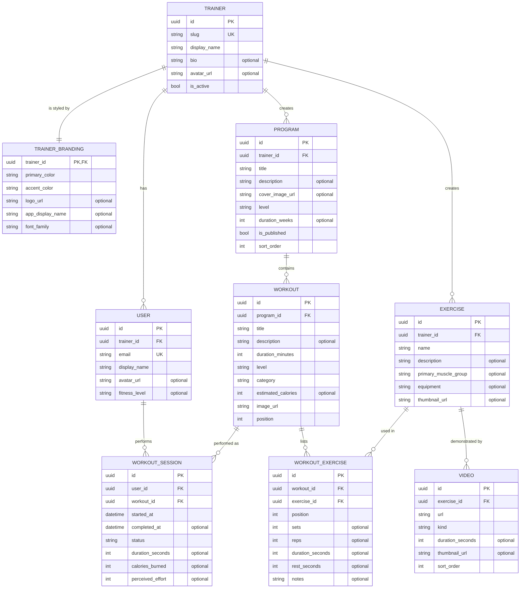

# Domain model

This document defines the entities, fields and relationships of the mypersonalfit backend. It is the reference for the API contract (MYP-9) and the database schema (MYP-10).

## 1. Overview

**Tenancy model: one app, many trainers.** There is a single app in the App Store. Every trainer publishes their own content (programs, workouts, exercises, videos) and their own branding. Every user who signs in is linked to exactly one trainer, and sees only that trainer's content, with that trainer's look and feel. "White-label" here means *per trainer at runtime*, not one app build per trainer.

```
Trainer ──owns──> Programs ──> Workouts ──> Exercises ──> Videos
   │
   ├──owns──> Branding (colors, logo, name shown in the app)
   │
   └──has───> Users ──log──> WorkoutSessions
```

### Conventions

| Topic | Rule |
|---|---|
| Primary keys | `id` is a UUID (string in the API). Exceptions are noted per entity. |
| Timestamps | Every table has `created_at` and `updated_at` (UTC, ISO 8601 in the API). Not repeated in the tables below. |
| Naming | `snake_case` in the database, `camelCase` in the API JSON and in Swift (`duration_minutes` ↔ `durationMinutes`). |
| Enums | Stored as lowercase strings. Raw values match the existing Swift enums (`WorkoutLevel`, `WorkoutCategory`). |
| Media | Images and videos are stored as URLs (`*_url`). Today the app uses asset-catalog names (`imageName`); these become URLs. |
| Ordering | Lists the trainer controls (programs, workouts in a program, exercises in a workout, videos) carry an integer order field. |
| Required / optional | **Req** = `NOT NULL`, always present in the API. **Opt** = nullable, may be omitted or `null` in the API. |

## 2. ER diagram



### Cardinalities

| Relationship | Cardinality | How it is stored |
|---|---|---|
| Trainer – TrainerBranding | 1 – 1 | `trainer_branding.trainer_id` is both PK and FK |
| Trainer – User | 1 – N | `user.trainer_id` |
| Trainer – Program | 1 – N | `program.trainer_id` |
| Trainer – Exercise | 1 – N | `exercise.trainer_id` (each trainer has their own exercise library) |
| **Program – Workout** | **1 – N** | `workout.program_id` |
| **Workout – Exercise** | **N – N** | join entity `workout_exercise` (also holds order, sets, reps, rest) |
| **Exercise – Video** | **1 – N** | `video.exercise_id` |
| User – WorkoutSession | 1 – N | `workout_session.user_id` |
| Workout – WorkoutSession | 1 – N | `workout_session.workout_id` |

## 3. Entities

### Trainer

The tenant. Owns all content and the branding a user sees.

| Field | Type | Req/Opt | Notes |
|---|---|---|---|
| `id` | UUID | Req | PK |
| `slug` | string | Req | Unique, URL-safe (e.g. `alex-rivera`). Used in invite links / deep links to link a user to the trainer. |
| `display_name` | string | Req | Shown on cards today as `trainerName`. |
| `bio` | text | Opt | |
| `avatar_url` | URL | Opt | |
| `is_active` | bool | Req | Default `true`. Inactive trainers' users can't access content. |

### TrainerBranding

The white-label traits the app loads after sign-in. Maps onto the app's design tokens (`AppColors`, `AppFont`), so the app keeps its layout and swaps the theme.

| Field | Type | Req/Opt | Notes |
|---|---|---|---|
| `trainer_id` | UUID | Req | PK and FK → Trainer |
| `primary_color` | string | Req | Hex `#RRGGBB`. Maps to `AppColors.textPrimary` / primary surfaces. |
| `accent_color` | string | Req | Hex `#RRGGBB`. Maps to `AppColors.accent`. |
| `logo_url` | URL | Opt | Falls back to the default app logo. |
| `app_display_name` | string | Opt | Name shown in the app header. Falls back to `Trainer.display_name`. |
| `font_family` | string | Opt | Must be a font bundled with the app (e.g. `Inter`). Falls back to the default. |

Kept as a separate entity (not columns on Trainer) so branding can grow (more colors, images, copy) without touching the Trainer table and can be cached separately by the app.

### User

The person who signs in to the app.

| Field | Type | Req/Opt | Notes |
|---|---|---|---|
| `id` | UUID | Req | PK. Will match the auth provider's subject id or link to it (decided in the auth task). |
| `trainer_id` | UUID | Req | FK → Trainer. Defines which content the user sees. |
| `email` | string | Req | Unique. |
| `display_name` | string | Req | Shown in the home greeting (today `ProgramsHome.userName`). |
| `avatar_url` | URL | Opt | |
| `fitness_level` | `WorkoutLevel` | Opt | Self-reported; can drive recommendations later. |

### Program

A collection of workouts published by a trainer (e.g. "8-week strength").

| Field | Type | Req/Opt | Notes |
|---|---|---|---|
| `id` | UUID | Req | PK |
| `trainer_id` | UUID | Req | FK → Trainer |
| `title` | string | Req | |
| `description` | text | Opt | |
| `cover_image_url` | URL | Opt | |
| `level` | `WorkoutLevel` | Req | |
| `duration_weeks` | int | Opt | `null` for open-ended programs. |
| `is_published` | bool | Req | Default `false`. Drafts are hidden from users. |
| `sort_order` | int | Req | Order of programs within the trainer's catalog. |

### Workout

A single training session inside a program. Evolves the existing Swift `Workout`.

| Field | Type | Req/Opt | Notes |
|---|---|---|---|
| `id` | UUID | Req | PK |
| `program_id` | UUID | Req | FK → Program |
| `title` | string | Req | |
| `description` | text | Opt | |
| `duration_minutes` | int | Req | > 0 |
| `level` | `WorkoutLevel` | Req | |
| `category` | `WorkoutCategory` | Req | |
| `estimated_calories` | int | Opt | Required today in Swift; optional in the backend because trainers may not provide it. |
| `image_url` | URL | Req | Replaces `imageName`. |
| `position` | int | Req | Order inside the program. Unique per (`program_id`, `position`). |

The trainer is not stored on the workout: it is derived through `program.trainer_id`. The API can still return a denormalized `trainer` object for display.

### WorkoutExercise (join entity)

Resolves Workout N–N Exercise and holds how the exercise is performed in that workout.

| Field | Type | Req/Opt | Notes |
|---|---|---|---|
| `id` | UUID | Req | PK. A surrogate key (instead of `workout_id + exercise_id`) so the same exercise can appear more than once in a workout. |
| `workout_id` | UUID | Req | FK → Workout |
| `exercise_id` | UUID | Req | FK → Exercise |
| `position` | int | Req | Order in the workout. Unique per (`workout_id`, `position`). |
| `sets` | int | Opt | |
| `reps` | int | Opt | Rep-based exercises. |
| `duration_seconds` | int | Opt | Time-based exercises (e.g. plank 45 s). |
| `rest_seconds` | int | Opt | Rest after the exercise. |
| `notes` | text | Opt | Trainer cues ("keep your back straight"). |

Rule: at least one of `reps` or `duration_seconds` must be set.

### Exercise

A reusable movement in the trainer's library (e.g. "Squat").

| Field | Type | Req/Opt | Notes |
|---|---|---|---|
| `id` | UUID | Req | PK |
| `trainer_id` | UUID | Req | FK → Trainer. Libraries are per trainer, so each trainer controls their own videos and cues. |
| `name` | string | Req | |
| `description` | text | Opt | |
| `primary_muscle_group` | string | Opt | Free text for now; may become an enum. |
| `equipment` | string | Opt | Free text for now (e.g. "dumbbells"); may become an enum or list. |
| `thumbnail_url` | URL | Opt | |

### Video

A video that demonstrates an exercise.

| Field | Type | Req/Opt | Notes |
|---|---|---|---|
| `id` | UUID | Req | PK |
| `exercise_id` | UUID | Req | FK → Exercise |
| `url` | URL | Req | Streaming/playback URL (HLS or MP4; decided with the media hosting task). |
| `kind` | `VideoKind` | Req | |
| `duration_seconds` | int | Opt | |
| `thumbnail_url` | URL | Opt | |
| `sort_order` | int | Req | Order of videos for the exercise. |

### WorkoutSession

A user's attempt at a workout. The basis for history and progress.

| Field | Type | Req/Opt | Notes |
|---|---|---|---|
| `id` | UUID | Req | PK |
| `user_id` | UUID | Req | FK → User |
| `workout_id` | UUID | Req | FK → Workout |
| `started_at` | datetime | Req | |
| `completed_at` | datetime | Opt | Set when `status = completed`. |
| `status` | `SessionStatus` | Req | |
| `duration_seconds` | int | Opt | Actual time spent. |
| `calories_burned` | int | Opt | From the app or HealthKit. |
| `perceived_effort` | int | Opt | RPE 1–10, entered by the user at the end. |

## 4. Enums

| Enum | Values | Notes |
|---|---|---|
| `WorkoutLevel` | `beginner`, `intermediate`, `advanced` | Same as Swift `WorkoutLevel`. |
| `WorkoutCategory` | `strength`, `cardio`, `core`, `mobility` | Same as Swift `WorkoutCategory`. |
| `VideoKind` | `demo`, `tutorial`, `variation` | `demo`: short loop; `tutorial`: full explanation; `variation`: easier/harder version. |
| `SessionStatus` | `in_progress`, `completed`, `abandoned` | |

## 5. Business rules

1. **Trainer scoping.** A user can only read content whose trainer is `user.trainer_id`: programs, workouts (via program), exercises, videos (via exercise) and branding. The API resolves the trainer from the signed-in user, never from a client parameter.
2. **Same-trainer content.** Every exercise in a workout (`workout_exercise.exercise_id`) must belong to the same trainer as the workout's program.
3. **Publishing.** Programs with `is_published = false`, and all their workouts, are hidden from users.
4. **Sessions.** A user can only create a `WorkoutSession` for a workout visible to them (rules 1 and 3).
5. **Session status.** `completed_at` is set if and only if `status = completed`; `completed_at >= started_at`.
6. **Inactive trainer.** If `trainer.is_active = false`, their users can sign in but see no content (exact UX decided later).
7. **Deletion.** Content that has `WorkoutSession` rows is not hard-deleted (archive/unpublish instead), so history stays valid.

## 6. Mapping from the current app

| Current (Swift) | New model | Change |
|---|---|---|
| `Workout.id: String` | `workout.id` (UUID) | Mock ids like `full-body-30` become UUIDs. |
| `Workout.title` | `workout.title` | — |
| `Workout.durationMinutes` | `workout.duration_minutes` | — |
| `Workout.level` | `workout.level` | — |
| `Workout.category` | `workout.category` | — |
| `Workout.estimatedCalories: Int` | `workout.estimated_calories` | Becomes optional. |
| `Workout.trainerName` | `trainer.display_name` via `program.trainer_id` | Removed from Workout; API returns it denormalized. |
| `Workout.imageName` | `workout.image_url` | Asset name → URL. |
| — | `workout.program_id`, `workout.position`, `workout.description` | New. |
| `ProgramsHome.userName` | `user.display_name` | — |
| `ProgramsHome.categories` | `WorkoutCategory` enum | Not stored; derived or static. |
| `ProgramsHome.popularWorkouts` | Query over `workout` (+ `workout_session` counts) | Not stored. |
| `FeaturedWorkout.badge` | — | Not modeled yet (see open questions). |

## 7. Open questions / future

- **Switching or multiple trainers.** Today a user belongs to exactly one trainer (`user.trainer_id`). If users need to change trainer or follow several, replace it with a `Membership` (User N–N Trainer) entity with `status` and `joined_at`.
- **How a user gets linked to a trainer.** Invite link with `trainer.slug`, invite code, or choosing at sign-up. Decided in the auth/onboarding task.
- **Featured workout ("TODAY'S PICK").** Manual curation by the trainer (a `featured_workout` table with date and badge) or computed. Not modeled yet.
- **Trainer admin accounts.** Trainers will need to sign in to a back-office to manage content; likely a separate `TrainerAccount`/role on User. Out of scope here.
- **Subscriptions / payments.** Not modeled.
- **Per-set logging.** `WorkoutSession` stores totals only; logging each set (weight, reps done) would add a `SessionSet` entity.
- **Localization** of titles/descriptions. Single language for now.
